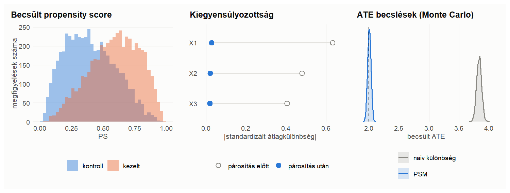
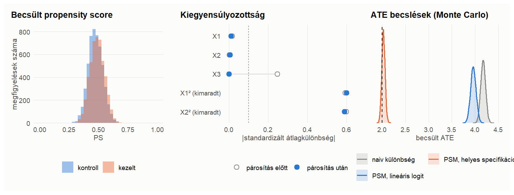
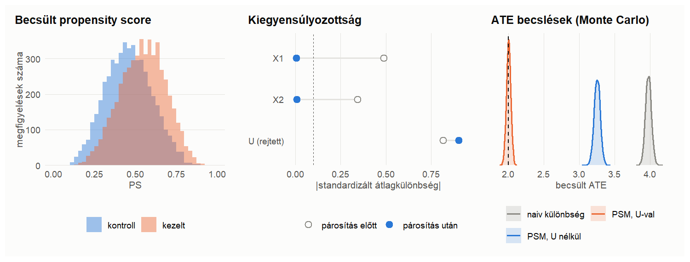
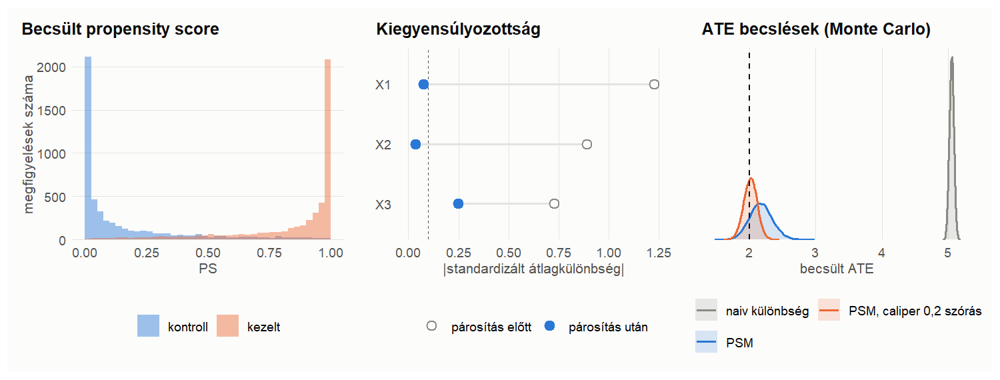
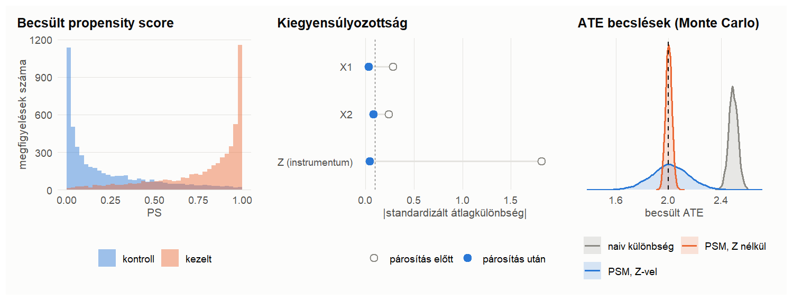

Propensity score matching: szimuláció
================
2026. 10. 12.

- [Felépítés](#felépítés)
- [Forgatókönyvek](#forgatókönyvek)
  - [A) Működik: jól specifikált
    PS-modell](#a-működik-jól-specifikált-ps-modell)
  - [B) Csőd: rosszul specifikált
    PS-modell](#b-csőd-rosszul-specifikált-ps-modell)
  - [C) Csőd: meg nem figyelt
    confounder](#c-csőd-meg-nem-figyelt-confounder)
  - [D) Gyenge overlap](#d-gyenge-overlap)
  - [E) Instrumentum a PS-modellben](#e-instrumentum-a-ps-modellben)
- [Összefoglalás](#összefoglalás)

# Felépítés

Minden forgatókönyvben a kezelés valódi hatása konstans, $\tau = 2$, így
ATE = ATT = 2. A confounderek standard normálisak, a kezelés logit
modellből származik:

$$T_i \sim \text{Bernoulli}\bigl(\Lambda(\text{index}_i)\bigr), \qquad Y_i = y_0(X_i) + \tau T_i + \varepsilon_i, \quad \varepsilon_i \sim N(0,1).$$

**Becslő.** Logisztikus regresszióval becsült propensity score, majd 1:1
legközelebbi szomszéd párosítás a PS logitján, visszatevéssel, **mindkét
irányban** (minden kezeltnek egy kontroll és minden kontrollnak egy
kezelt pár). Az egyéni hatások átlaga így az **ATE**-t becsli.
Viszonyítási alap a naiv átlagkülönbség. Forgatókönyvenként 5 000
ismétlés, $n = 10 000$.

# Forgatókönyvek

Minden forgatókönyvnél balra egy minta becsült PS-eloszlása, középen a
kiegyensúlyozottság (\|SMD\| párosítás előtt és után, a 0,1-es
küszöbbel), jobbra a Monte Carlo becslések eloszlása (szaggatott vonal:
a valódi hatás).

## A) Működik: jól specifikált PS-modell

$\text{index} = 0{,}8X_1 - 0{,}6X_2 + 0{,}5X_3$,
$\; y_0 = 1{,}5X_1 - X_2 + X_3$. Minden confounder megfigyelt, a
PS-modell helyes.

A naiv különbség torzítása 1,83, a PSM-é 0,004. A párosítás után minden
\|SMD\| a küszöb alatt van.

## B) Csőd: rosszul specifikált PS-modell

$\text{index} = 0{,}6(X_1^2 - 1) + 0{,}6(X_2^2 - 1) + 0{,}3X_3$,
$\; y_0 = 1{,}2X_1^2 + 1{,}2X_2^2 + X_3$. A kezelés a négyzetes tagoktól
függ, a becsült modell viszont lineáris logit.

A lineáris PS alig jelzi előre a kezelést (AUC = 0,57), a torzítás 1,96
marad. Az $X$-ek kiegyensúlyozottak, a négyzetes tagok viszont nem. A
négyzetes tagokkal bővített modell torzítása 0,03.

## C) Csőd: meg nem figyelt confounder

$\text{index} = 0{,}6X_1 - 0{,}5X_2 + U$, $\; y_0 = X_1 - X_2 + 1{,}5U$,
ahol $U$ nem megfigyelt.

A párosítás tökéletesen kiegyensúlyozza a megfigyelt változókat, ezért
az ellenőrzés hamis biztonságot ad. Az $U$ kiegyensúlyozatlan marad, a
torzítás 1,25. Ha $U$ megfigyelhető lenne, a torzítás 0,005 volna.

## D) Gyenge overlap

Mint az A), de négyszer erősebb szelekció, így a PS-ek 0 és 1 közelébe
szorulnak.

Kevés a hasonló pár, ugyanazokat a megfigyeléseket sokszor párosítjuk: a
PSM torzítása 0,175, szórása 0,175. A 0,2 szórásnyi caliper a torzítást
0,01-ra csökkenti, de csak a megfigyelések 87%-át tartja meg. Heterogén
hatásnál ez már egy másik sokaság átlagos hatása lenne.

## E) Instrumentum a PS-modellben

$\text{index} = 0{,}6X_1 - 0{,}5X_2 + 3Z$, $\; y_0 = X_1 - X_2$. A $Z$
csak a kezelésre hat, a kimenetre nem.

A $Z$ bevonása javítja a PS előrejelző erejét (AUC = 0,92), torzítást
nem okoz, de rontja az overlapet: a szórás 0,145, szemben a nélküle
kapott 0,024-mal. A jó PS-modell nem a legjobb előrejelző, hanem a
confoundereket tartalmazó modell.

# Összefoglalás

|     | Becslő                   | Átlag | Torzítás | Szórás |  RMSE |   AUC | Megtartott (%) |
|:----|:-------------------------|------:|---------:|-------:|------:|------:|---------------:|
| A   | naiv különbség           | 3,833 |    1,833 |  0,042 | 1,834 |       |         100,00 |
| A   | PSM                      | 2,004 |    0,004 |  0,028 | 0,029 | 0,759 |         100,00 |
| B   | naiv különbség           | 4,172 |    2,172 |  0,052 | 2,172 |       |         100,00 |
| B   | PSM, lineáris logit      | 3,960 |    1,960 |  0,059 | 1,961 | 0,569 |         100,00 |
| B   | PSM, helyes specifikáció | 2,029 |    0,029 |  0,036 | 0,046 | 0,746 |         100,00 |
| C   | naiv különbség           | 3,977 |    1,977 |  0,041 | 1,978 |       |         100,00 |
| C   | PSM, U nélkül            | 3,254 |    1,254 |  0,043 | 1,255 | 0,670 |         100,00 |
| C   | PSM, U-val               | 2,005 |    0,005 |  0,031 | 0,031 | 0,782 |         100,00 |
| D   | naiv különbség           | 5,050 |    3,050 |  0,034 | 3,051 |       |         100,00 |
| D   | PSM                      | 2,175 |    0,175 |  0,175 | 0,247 | 0,957 |         100,00 |
| D   | PSM, caliper 0,2 szórás  | 2,013 |    0,013 |  0,102 | 0,103 | 0,957 |          87,17 |
| E   | naiv különbség           | 2,493 |    0,493 |  0,035 | 0,495 |       |         100,00 |
| E   | PSM, Z-vel               | 2,010 |    0,010 |  0,145 | 0,146 | 0,923 |         100,00 |
| E   | PSM, Z nélkül            | 2,001 |    0,001 |  0,024 | 0,024 | 0,599 |         100,00 |

- A PSM akkor működik, ha minden confounder megfigyelt, és a PS-modell
  helyesen specifikált (A).
- A kiegyensúlyozottsági ellenőrzés csak a megfigyelt és a modellbe
  bevont változókra mond valamit (B, C).
- A megfigyelhetetlen confounder okozta torzítás az adatokból nem
  szűrhető ki (C).
- Gyenge overlap mellett a becslés zajos és torzított. A caliper segít,
  de megváltoztatja a becsült sokaságot (D).
- A PS-modellbe a confoundereket kell tenni, nem a kezelés legjobb
  előrejelzőit (E).
